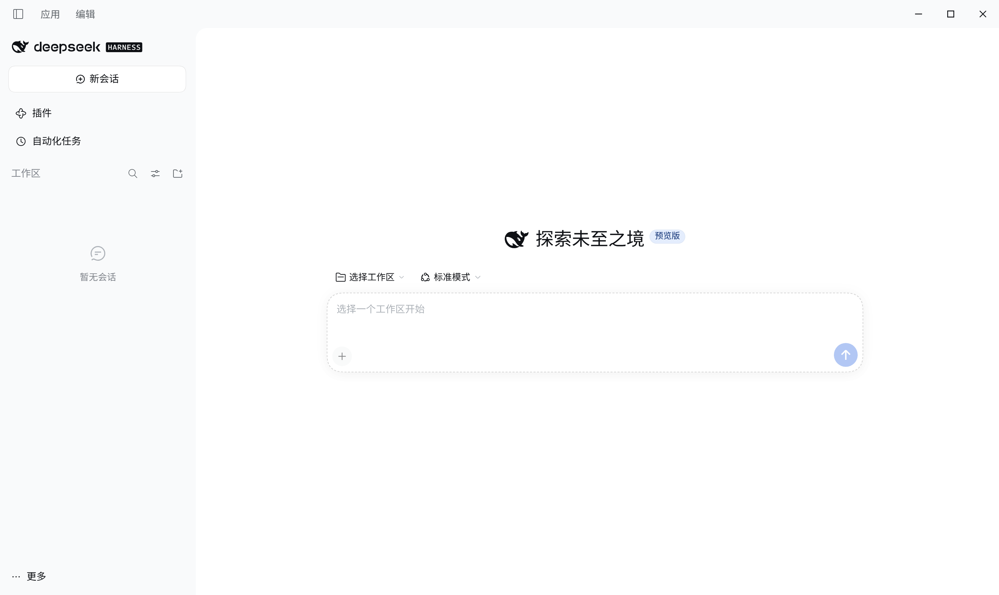

# dsh-desktop-linux

[中文](README.md) | **English**

> An independent community project. **Not** an official DeepSeek product, and not
> affiliated with DeepSeek.

Ports the **packaging pipeline** of the official
[DeepSeek Harness](https://github.com/deepseek-ai/deepseek-harness) desktop app
(the Electron application in `apps/desktop`) to Linux, producing
AppImage / deb / rpm / Arch packages.

Upstream explicitly does not support Linux today (`apps/desktop/README.md`:
*"Linux is not a supported Desktop release target."*). This project fills exactly
that gap: it teaches the official packaging pipeline about `linux-x64` and emits
installable artifacts. See [Validation status](#validation-status) for what has
actually been tested.




## How this fork differs from the original project

This repository is a fork of [ffyfox/dsh-desktop-linux](https://github.com/ffyfox/dsh-desktop-linux),
based on its `2d52dac` (upstream `dsh-v0.2.2-alpha.2`). **The packaging pipeline itself is unchanged**:
only `0003` among patches `0001`–`0018` carries additions from this fork (see the table below); the
`scripts/` and `PKGBUILD` build logic are the original project's. This fork only adds:

| Change | Content |
|---|---|
| New patch `0019-desktop-linux-frameless-caption.patch` | In normal mode the Linux main window becomes **frameless**: it reuses the caption seat `0016` already wires up, draws its own minimize / maximize / close through `dsh-desktop:window-controls`, and the main process publishes the maximized state. Glass mode keeps the native frame; the tray switch picks between the two |
| New patch `0020-desktop-linux-tray-glass-switch.patch` | A "Glass mode" checkbox in the tray menu: clicking asks for confirmation (Restart / Cancel), then writes the choice to `settings.json` under Electron's userData and restarts; cancelling keeps the current mode. `DSH_DESKTOP_GLASS` still works; once the tray has written a choice, the tray wins |
| New patch `0021-desktop-linux-official-branding.patch` | Linux unsigned builds switch to the official client profile, so the app shows the official DSH brand in the top-left instead of the upstream local profile's "DSH Local Build" badge; unsigned macOS / Windows builds are unaffected |
| Patch `0003` extended | The deb and rpm packages declare `libdbusmenu-glib.so.4`, which the tray menu needs (the original project only declares it in the Arch PKGBUILD `depends`); `afterInstall` is taken over to prune empty `node_modules` directories left by a previous version, so upgrades heal themselves |
| `scripts/verify.sh` | One artifact assertion: the window control channel in the main process and the caption module in the preload |
| Known limitations | One measured conclusion: a third-party plugin carrying a NAN native module built for Electron segfaults the Host |
| `PKGBUILD` | Gains `0019` / `0020` and the new `0003` hash |
| Screenshot | The header image shows what this fork actually runs: the frameless title bar |
| Glass mode (`0018`) | Already in the original project and inherited as-is; the tray switch (`0020`) is the added entry point |

Tracking upstream works exactly as in the original project: `scripts/fetch-upstream.sh` fetches the
commit `PKGBUILD`'s `_tag` names and the patches are generated against it. **The two patches this fork adds are
verified inside this fork**: both patch paths are clean, the 5 official typecheck gates pass, the
full upstream desktop unit suite passes (2027 passed / 63 skipped), `build.sh --all` produces all
three artifacts, and the `verify.sh --runtime` live matrix is green (the persisted glass-mode read
path got a live smoke test as well).

## What this project produces

What this project ships is **the official Electron application itself**:

- the renderer loads over its own `dsh-app://` protocol rather than connecting to a local web server;
- it carries its own Node / pnpm / Python runtime and does not use the system Node;
- it owns `$DSH_HOME/profiles/desktop` exclusively and does not touch the `web` profile.

The cost is a much heavier build: clone the upstream monorepo, run the pnpm
workspace build, then package with electron-builder.

## Install

Download the AppImage, deb and rpm artifacts from [Releases](https://github.com/ffyfox/dsh-desktop-linux/releases).

| Distribution | Format | How |
|---|---|---|
| Any | AppImage | `chmod +x`, run it |
| Debian / Ubuntu | deb | `sudo apt install ./deepseek-harness-*.deb` |
| Fedora / RHEL | rpm | `sudo dnf install ./deepseek-harness-*.rpm` |
| Arch Linux | PKGBUILD | Shipped in the repo, built locally with `makepkg` (not published to the AUR) — see [Arch package](#arch-package) |

Artifacts are **unsigned** builds (the file name carries `-unsigned`). Once
installed, `dsh://` links are handed to it.

## Building from source

Requirements: Node 24.9+ (**not your distro's own Node** — see below), **pnpm 11**, and git.
Building the rpm additionally needs `rpmbuild` on the system.

```bash
git clone https://github.com/ffyfox/dsh-desktop-linux
cd dsh-desktop-linux

./scripts/fetch-upstream.sh      # fetch upstream sources (defaults to the tag pinned in PKGBUILD)
./scripts/apply-patches.sh       # apply the patch series
./scripts/build.sh --all         # AppImage + deb + rpm
./scripts/verify.sh --runtime    # verification matrix
```

`build.sh` flags: `--dir` (unpacked directory only, fastest), `--appimage`
(default), `--deb`, `--rpm`, `--all`. The long pole is the pipeline itself
(`build:official` → `release:pack` → `prepare:*` → `package`); each extra format
only adds one fpm/AppImage packaging pass, so building formats separately is both
faster and easier to debug.

Artifacts land in
`upstream/apps/desktop/.desktop-build/targets/linux-x64/unsigned-artifacts/`.

The deb / rpm `Maintainer:` / `Homepage:` come from `upstream/apps/desktop/.env.linux`.
`build.sh` creates it on first run from the repo's `.env.linux.example`, values already filled in.
To change them, edit that file: **the same-named environment variables are filtered out by
upstream**, so `DSH_DESKTOP_LINUX_MAINTAINER=… build.sh --deb` is silently ignored.

### Hard requirements

**Node must have TypeScript type stripping enabled.** Release builds from nodejs.org do, but
distro packages may not, and the build then dies in its first step (`build:official`) with
`build: Node.js TypeScript type stripping is unavailable`. Use Node from nodejs.org; CI pins Node 24.

**pnpm 11 is required, installed via npm or corepack.** The upstream repository declares
`packageManager: pnpm@11.28.5`, and pnpm 11 switches to that version by itself.
pnpm 9 fails `pnpm install` with `ERR_PNPM_LOCKFILE_CONFIG_MISMATCH`. The official standalone
installer and Homebrew ship a compiled binary, and three upstream scripts then run
`node $npm_execpath` and die with `SyntaxError`; `build.sh` falls back to the isolated copy and says so.

**PKGBUILD runs the same check.** `build()` carries an inlined copy of that entry probe: if the
system pnpm is not 11.x, or the entry it hands to scripts cannot be run by node, it falls back to
`~/.local/share/dsh-pnpm-11`; if neither works it prints the install command and stops, instead of
dying with `SyntaxError` in the middle of the packaging pipeline.

## Arch package

The PKGBUILD consumes upstream's release tarball and does not depend on the
`./upstream` checkout:

```bash
./scripts/pkgbuild-dir.sh     # flatten into ./pkgbuild
cd pkgbuild && makepkg -si
```

This project is not published to the AUR; the PKGBUILD is for local builds only.

The Arch package installs the unpacked tree into `/opt/deepseek-harness-desktop`
and symlinks `/usr/bin/deepseek-harness`.

## How it works

```
Official Electron shell (apps/desktop)
├── renderer ──── dsh-app:// protocol ──── application UI
└── Host process ─── real Node from primary-runtime ─── bundled dsh runtime
                          └── $DSH_HOME/profiles/desktop
```

Three design points worth knowing:

- **The Host runs on a real Node, not Electron's node mode.** Under Electron's
  node mode `sharp` segfaults while decoding, so on Linux the Host uses the Node
  bundled in primary-runtime. Consequently **Linux artifacts do not put the dsh
  tree into an asar** (a real Node cannot read inside an archive), which is why
  `linux-unpacked` is large.
- **The profile is exclusive.** The desktop uses `$DSH_HOME/profiles/desktop`, and
  the CLI rejects that profile at the argument layer
  (`error: profile "desktop" is managed exclusively by the Electron application`).
  Sessions, settings, and credentials still live at the root of `$DSH_HOME`, shared
  with the CLI. To reuse your web configuration, migrate it once: quit the desktop app,
  then copy or rename `$DSH_HOME/profiles/web` into place and let the two evolve
  separately afterwards; sharing a single directory through a symlink works in practice,
  but the two sides overwrite each other, the desktop's startup recovery acts on that
  shared directory as well, and unknown problems may appear once the two sides diverge.
- **Sandboxing.** Where the kernel supports unprivileged user namespaces, the
  renderer runs in a namespace sandbox (separate user namespace + seccomp); only
  where it does not does it fall back to a setuid `chrome-sandbox`. The AppImage
  leaves this to AppRun's own probe, and the deb / rpm / Arch packages make the
  same decision in their postinst.

### Closing, the tray, and quitting

**Closing the window does not fully quit the application — that is upstream's design.** Upstream
`main.ts` intercepts the main window's `close` and **hides** it instead: the Host keeps running,
tasks in progress are not interrupted, and session write locks are not released.

Upstream provides no Linux path to **"get back to the hidden window"** or to
**"fully quit the application"**. Following upstream's implementation on the other platforms,
patch `0013` adds the tray: the icon stays for the whole run and carries a tray menu.

- To get the window back: the tray menu's "Open", or launch the application again (a second launch
  only focuses the instance that is already running).
- To really quit: the tray menu's "Quit", "Quit" in the title bar's Application menu, or `Ctrl+Q`.
- To switch glass mode: the "Glass mode" checkbox in the tray menu (see [Glass mode](#glass-mode)).

**The title bar is drawn locally in normal mode.** Electron carries no Window Controls Overlay on
Linux, so patch `0019` drops the main window's OS frame and reuses the same caption seat Windows
receives from that overlay for a 40 DIP title bar: the sidebar toggle and the `Application / Edit`
menus on the left (patch `0016` wires those Windows-style caption menu buttons to Linux), the
self-drawn minimize / maximize / close on the right, both following the light and dark theme, and a
drag region everywhere else. "Close" means the same as the system close button — hide the window, not
quit. Glass mode keeps the native frame and the native window buttons and therefore has no such
title bar.

### Plugin market host version

The plugin market reads the host version correctly ("Host version unknown" is fixed by patch
`0017`): on Linux the Host process is a standalone Node (see patch `0008`) and has no Electron
`process.resourcesPath`, so dsh-market's host lookup came up empty. `0017` passes the packaged
resources root to the Host and republishes it there; the lookup works again, and so do the
compatibility filter and "update to a compatible version".

### Glass mode

A translucent / frosted-glass sidebar (patch `0018`, from the original project). **The easiest entry
is the "Glass mode" checkbox in the tray menu** (patch `0020`):

- Its state comes from the running instance. Clicking asks for confirmation (Restart / Cancel): only
  on confirm is `appearance.glass` written into `settings.json` and the application relaunched so the
  new window starts transparent — cancelling changes nothing and the checkbox falls back to the live
  mode. `transparent` is a window creation option, so this one needs a restart.
- Until the tray has written a choice, the environment variable still works:
  `DSH_DESKTOP_GLASS=1 deepseek-harness`. Once the tray has written one, the tray wins — otherwise a
  relaunch that still carries the variable would immediately flip the switch back. Windows trays have
  no such item.
- The window then follows the official desktop app's macOS layout: the native menu bar auto-hides and
  appears on `Alt`; collapsing the sidebar removes the column entirely and moves the chrome to the
  leading seat; the window keeps its native frame, which is why it is mutually exclusive with the
  frameless normal mode.
- Sidebar fill defaults: 40% in the light theme, 50% in the dark theme. Override with
  `DSH_DESKTOP_GLASS_TINT=0..100`.
- **Blur is up to the compositor**: Hyprland blurs (with `decoration:blur` enabled);
  niri needs `background-effect { blur true }` in its own configuration;
  KDE and GNOME do not blur — the sidebar is merely translucent, so raise the fill
  when text gets hard to read.

## Validation status

**Only a few environments have been tested so far, and we intend to widen that coverage.**
Both tables below are kept up to date as reports come in — please tell us how it goes in
[Issues](https://github.com/ffyfox/dsh-desktop-linux/issues), whether it works or not.

### Environment

| Environment | Status |
|---|---|
| Arch Linux · KDE Plasma 6 · Wayland · x86_64 | **Tested**, works |
| Arch Linux · Hyprland 0.56 · Wayland · x86_64 | **Tested**, works |
| Arch Linux · niri 26.04 · Wayland · x86_64 | **Tested**, works |
| Ubuntu 26.04 LTS · GNOME 50 · Wayland · x86_64 | **Tested**, works (Ubuntu ships the tray host) |
| Debian 13 · GNOME 48 · Wayland · x86_64 | **Tested**, works (the tray needs an extra extension, see [Known limitations](#known-limitations)) |
| Fedora 44 Workstation · GNOME 50 · Wayland · x86_64 | **Tested**, works (the tray needs an extra extension, see [Known limitations](#known-limitations)) |
| Other distributions (Linux Mint / CachyOS, …) | Not tested |
| Other desktops / WMs (Xfce, Sway, …) | Not tested |
| X11 | Not tested |
| aarch64 | Not built, not tested |

### Artifacts

| Artifact | Status |
|---|---|
| AppImage | **Tested**: `chmod +x` → launch → tray, window close → quit |
| deb | **Tested**: `apt install` → launch → tray, window close → quit |
| rpm | **Tested**: `dnf install` → launch → tray, window close → quit |
| Arch package | **Tested**: `makepkg` → `pacman -U` → launch, sandbox, uninstall |
| `linux-unpacked` | **Tested**: `verify.sh --runtime` live matrix |

## Known limitations

- **GNOME shows no tray by default — install the extension yourself.** The tray uses freedesktop
  StatusNotifierItem, and GNOME ships no host for it, so you need `gnome-shell-extension-appindicator`
  (Ubuntu installs it by default; Debian needs its own `apt install` and Fedora its `dnf install`).
  Two traps after installing: the extension's UUID is `ubuntu-appindicators@ubuntu.com` (that is the
  name in Debian 13's 59-4 —
  the `appindicatorsupport@rgcjonas.gmail.com` of older docs is obsolete), and **newly installed
  extensions are not hot-loaded**, so you must log out and back in. Without a tray host the icon never
  appears, and a hidden window can then only be recovered by launching the application again.
- **The AppImage needs FUSE 2 (`libfuse.so.2`) on the system.** Mainstream distributions now install
  only FUSE 3 (Debian 13, Ubuntu 26.04 and Fedora 44 all ship just `libfuse3.so.3`), so running it
  stops at `dlopen(): error loading libfuse.so.2`. Install the matching package — Fedora
  `sudo dnf install fuse-libs`, Debian 13 and Ubuntu 24.04+ `sudo apt install libfuse2t64`
  (`libfuse2` on Ubuntu 22.04) — or bypass the mount with
  `APPIMAGE_EXTRACT_AND_RUN=1 ./deepseek-harness-*.AppImage` (extracts to /tmp, about 1.2G extra).
  The deb, rpm and Arch packages are unaffected.
- **A third-party plugin with a native module built for Electron stops the whole desktop app.** The
  Linux Host runs on the bundled Node (not Electron's node mode), so a **NAN** native module compiled
  for Electron (NAN is not ABI-stable) loads and then segfaults on first call. The app reports that it
  could not start or stopped unexpectedly, the terminal shows only `dsh desktop host stopped`, and
  stderr is empty — a segfault carries no JavaScript stack. Observed with `@linxin666/dsh-ssh` →
  `ssh2` → `cpu-features` (its `build/config.gypi` records a higher `node_module_version` than the
  Host's ABI). Crash reports land in
  `~/.config/@deepseek-ai/dsh-desktop/logs/crash-*-host.log`. Recovery only touches that native
  module: move it aside
  (`mv ~/.dsh/profiles/desktop/node_modules/cpu-features{,.disabled}`, and `ssh2` falls back to its
  JavaScript implementation) or rebuild it for the local Node
  (`npm rebuild cpu-features --build-from-source`); the plugin itself can stay enabled.
- **In normal mode the three window buttons have English tooltips.** Windows draws its caption
  buttons and gets the wording localized from the system; this one is drawn locally
  (`minimize` / `maximize` / `close`), while the `Application / Edit` caption menu labels follow the
  application language. Glass mode uses the native window buttons and is not affected.
- **No auto-update.** Upstream's mandatory-update policy channel only recognises
  `desktop-win` / `desktop-mac` client identities, and Linux artifacts carry no
  update channel, so the Linux build embeds no policy, never polls, and never
  updates itself.
- **No "install the command line tool" entry.** The official desktop offers one on macOS and Windows:
  it puts the bundled `dsh` CLI on your PATH (a privileged symlink at `/usr/local/bin/dsh` on macOS, a
  user PATH edit on Windows), and upstream implements only those two branches, so the Linux artifacts
  have none. To use `dsh` in a terminal, install it yourself, or run the copy the application ships
  (`resources/app/dsh/node_modules/@deepseek-ai/dsh/lib/bin.js`, with the node under
  `resources/runtime/primary-runtime`).
- **Unsigned.** Artifacts are unsigned builds.
- **Platform sees a Linux client as macOS.** Upstream maps client identity with
  `platform === 'win32' ? 'desktop-win' : 'desktop-mac'`, so Linux lands on
  `desktop-mac`. That follows from upstream's `'darwin' | 'win32' | null` union
  and is not introduced here; the same request reports `device_model` as
  `linux-x64`.
- **`linux-unpacked` is about 1.1G.** With asar disabled it is a tree of small
  files; the AppImage compresses it to 339M, but first launch reads more files
  than an asar build would.
- **x86_64 only.**

## License

MIT
